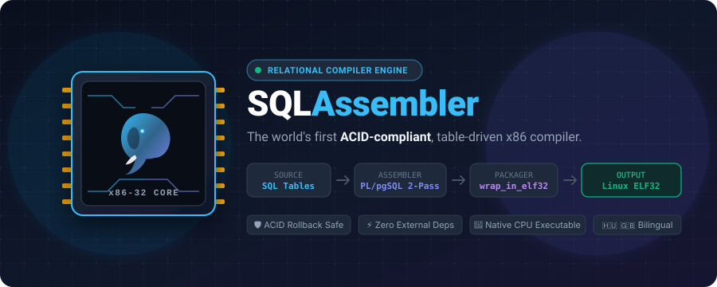
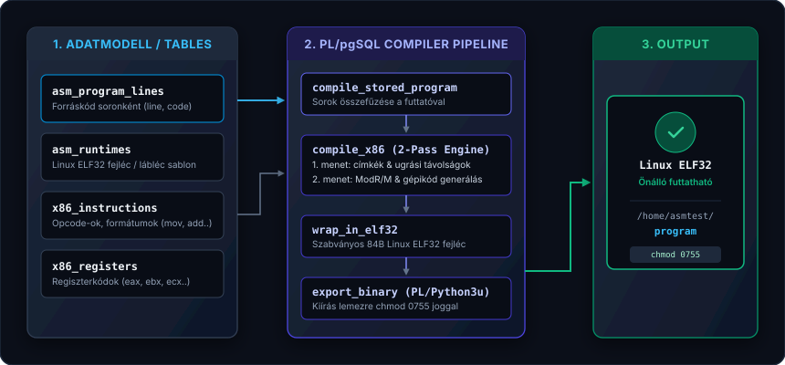

<p align="center">
  
</p>

<p align="center">
  <a href="https://www.postgresql.org/"></a>
  
  
  
</p>

<p align="center">
  <a href="#magyar-leiras">Magyar leírás</a> | <a href="#english-description">English Description</a>
</p>

---

<a name="magyar-leiras"></a>
## Magyar leírás

### A projekt háttere

A fordítóprogramok évtizedek óta ugyanarra a megszokott sémára épülnek: szöveges fájlok a lemezen, nehezen átlátható Makefájlok és megfoghatatlan fordítási hibák.

Az SQLAssembler szakít ezzel a megközelítéssel: az x86 assembly forráskódot relációs táblákban tárolja, az utasításkészletet normalizált adatbázis-rekordokként kezeli, a kétmenetes fordítást és címkefeloldást pedig tiszta PL/pgSQL logikával végzi el. A végeredmény nem köztes kód vagy emuláció, hanem egy valódi, közvetlenül futtatható 32 bites Linux ELF bináris.

Ha a forráskódban szintaktikai hiba vagy ismeretlen utasítás szerepel, a tranzakció megszakad, a ROLLBACK visszaállítja az állapotot, és a fájlrendszerre nem kerül csonka fájl.

### Megvalósítás és működés

A fordítási folyamat teljes egészében PostgreSQL tranzakcióban fut. Sikertelen fordítás esetén a tranzakció visszagördül, így semmilyen félkész szemét nem marad a háttértáron.

A mikroarchitektúra definíciója teljesen táblavezérelt: az opcode értékek, az operandus formátumok és a regiszterek az x86_instructions és x86_registers táblákban élnek. Új utasítás támogatása pusztán egy rekord beszúrását igényli, a fordító forráskódjának módosítása nélkül.

A gépikód csomagolását a wrap_in_elf32 függvény végzi, amely a memóriában állít össze egy szabványos 84 bájtos Linux ELF32 fejlécet. Az így kiexportált állomány közvetlenül futtatható a Linux kernel alatt, külső futtató vagy C környezet nélkül.

A lefordított binárisok működése közvetlenül SQL munkamenetből is ellenőrizhető a run_binary függvény segítségével.

---

### Architektúra

<p align="center">
  
</p>

---

### Használat

#### 1. Program rögzítése az adatbázisban

```sql
INSERT INTO asm_programs (name, description) 
VALUES ('demo', 'Szorzás ciklussal');

INSERT INTO asm_program_lines (program_name, line_number, line_code) VALUES
('demo', 10, 'xor eax, eax'),
('demo', 20, 'mov ebx, 5'),
('demo', 30, 'mov ecx, 4'),
('demo', 40, 'loop:'),
('demo', 50, 'add eax, ebx'),
('demo', 60, 'dec ecx'),
('demo', 70, 'jnz loop'),
('demo', 80, 'ret');
```

#### 2. Fordítás és export

```sql
CALL compile_stored_program('demo');
```

Az eljárás felolvassa és rendezi a sorokat, elvégzi a kétmenetes fordítást, ráilleszti a Linux sys_exit hívást és az ELF fejlécet, majd kimenti a fájlt a /home/asmtest/demo útvonalra futtatási jogosultsággal.

#### 3. Futtatás

Linux terminálból közvetlenül:

```bash
/home/asmtest/demo
echo $?
```

---

<a name="english-description"></a>
## English Description

### Background

Traditional compiler toolchains depend on loose source files, complex build tools, and scattered artifacts.

SQLAssembler takes a different route: assembly source code is stored row by row in database tables, CPU opcodes and registers are modeled as relational entities, and the two-pass assembly logic is implemented in PL/pgSQL. The output is a standalone 32-bit Linux ELF binary ready for direct execution.

When a syntax error occurs, relational transaction semantics protect the workspace: the transaction aborts, ROLLBACK restores the prior state, and no partial or broken binary is written to disk.

### Implementation details

Compilation runs entirely within a PostgreSQL transaction. If validation fails, no leftover artifacts remain on the filesystem.

The instruction set architecture is fully table-driven: opcode bytes, operand patterns, and register identifiers reside in the x86_instructions and x86_registers tables. Supporting a new instruction requires an INSERT statement rather than changes to assembler source code.

Binary packaging is handled by the wrap_in_elf32 routine, which constructs a compliant 84-byte Linux ELF32 header in memory. The exported file runs directly on bare metal under the Linux kernel with zero runtime dependencies.

---

### Project Layout

```text
sqlasm/
├── sql/
│   ├── tables/       # Schemas for registers, opcodes, runtimes, outputs
│   ├── functions/    # 2-pass compiler, ELF32 packager, exporter
│   └── procedures/   # compile_stored_program
└── README.md
```


